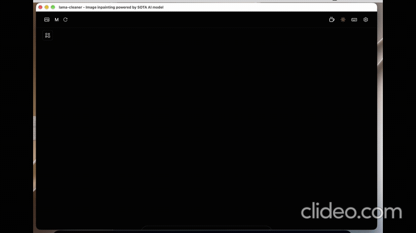

# Magic Eraser for macOS

A local desktop photo cleanup app powered by Lama Cleaner. The app runs in an Electron window and keeps the large AI models outside the application bundle.

## Demo



<video controls width="720">
	<source src="magicerasser.mp4" type="video/mp4">
	Your browser does not support embedded video. [Watch the MP4 demo](magicerasser.mp4).
</video>

## Run the App

Open the packaged app:

```bash
open "dist/mac-arm64/Magic Eraser.app"
```

On the first launch, choose the folder containing the model cache. The app remembers this location for future launches.

Expected model files:

```text
<model-folder>/torch/hub/checkpoints/big-lama.pt
<model-folder>/torch/hub/checkpoints/sam_vit_l_0b3195.pth
```

The current model folder is usually:

```text
~/.cache
```

The first startup can take about a minute while Torch and the models load. The app then opens the existing Lama Cleaner editor inside a native macOS window. Safari and Chrome are not required.

The setup screen also accepts direct `.pt` and `.pth` URLs. Downloaded files are placed in the selected model folder.

## Build the App

The packaged app is already built under `dist`. To rebuild the embedded Python runtime after changing dependencies:

```bash
source venv/bin/activate
./build_runtime.sh
```

Then rebuild the Electron app without macOS signing for local testing:

```bash
CSC_IDENTITY_AUTO_DISCOVERY=false npm run build
```

Run both commands from the project root. If dependencies are missing, install them first:

```bash
npm install
```

The rebuilt app is created at:

```text
dist/mac-arm64/Magic Eraser.app
```

## Runtime Layout

- `main.js`: Electron process and backend lifecycle
- `setup.html`: first-run model setup screen
- `preload.js`: secure renderer bridge
- `server_entry.py`: packaged Lama Cleaner entry point
- `runtime-dist`: PyInstaller runtime used by the app
- `dist`: generated application bundle
- `venv`: development environment used when rebuilding

The model files are intentionally not bundled into the app. This keeps the application smaller and lets users store the models on another disk.

## Project Layout

This repository is the flattened desktop app project; there is no separate `mac_app` directory.

```text
main.js              Electron main process
setup.html           Model setup screen
server_entry.py      Lama Cleaner entry point
runtime-dist/        Bundled Python runtime
dist/                Generated macOS app
venv/                Local rebuild environment
```

## Troubleshooting

The backend log is stored at:

```text
~/Library/Application Support/magic-eraser-desktop/lama-cleaner.log
```

If the app asks for models again, select the parent folder containing `torch/hub/checkpoints`, not the `checkpoints` folder itself.

## References

- [LaMa](https://github.com/advimman/lama): original resolution-robust image inpainting project
- [Lama Cleaner](https://github.com/Sanster/lama-cleaner): local image editing backend and web interface
- [Segment Anything](https://github.com/facebookresearch/segment-anything): interactive segmentation model

## License

See [LICENSE](LICENSE) for the original LaMa project license and attribution.
